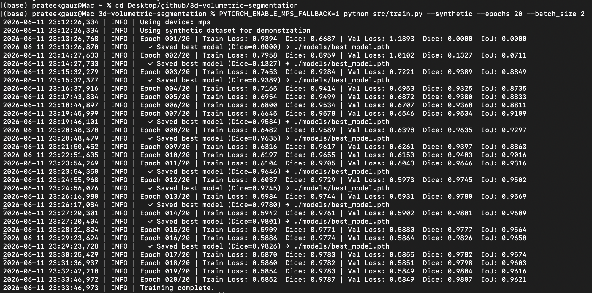

# 3D Structural & Volumetric Analysis Pipeline

> Modular agentic pipeline for 3D volumetric image segmentation using a custom PyTorch 3D U-Net. Designed for extracting dimensional measurements from complex engineering geometries (e.g., battery modules, structural components). Includes real-time push notifications via ntfy API.

---

> **📌 About this repo:** This is a showcase repo — write-up, architecture, and results only. The full implementation lives in a private core repo (kept private to protect the code and as a backup) and is available for a live walkthrough on request, e.g. in an interview.

---

## Project overview

This project implements an end-to-end 3D segmentation system that:
- Takes raw 3D volumetric data (CT scans, engineering scans) as input
- Segments regions of interest using a custom **3D U-Net** (PyTorch)
- Runs efficient **sliding-window inference** for large volumes
- Sends **real-time notifications** via ntfy.sh upon completion
- Reports Dice, IoU, Precision, Recall, and Volume Similarity metrics

---

## Architecture

```
3d-volumetric-segmentation/
├── src/
│   ├── model.py        # 3D U-Net architecture (encoder–decoder + skip connections)
│   ├── dataset.py      # Dataset loader + 3D augmentations (flip, random crop)
│   ├── train.py        # Training loop (Dice + CE loss, cosine LR scheduling)
│   ├── inference.py    # Sliding-window inference + ntfy push notifications
│   └── metrics.py      # Dice, IoU, F1, Volume Similarity
├── requirements.txt
└── README.md
```

---

## Setup

```bash
git clone https://github.com/PRATdoppelEK/3d-volumetric-segmentation.git
cd 3d-volumetric-segmentation
pip install -r requirements.txt
```

---

## Quickstart

### Train with synthetic data (no dataset needed — runs immediately)
```bash
python src/train.py --synthetic --epochs 20 --batch_size 2
```

### Train with your own volumetric data
```bash
# data_dir must contain:  images/*.npy  and  masks/*.npy
python src/train.py --data_dir ./data --epochs 50 --batch_size 2 --lr 1e-4
```

### Run inference with ntfy push notification
```bash
python src/inference.py \
  --model_path  models/best_model.pth \
  --input_path  data/sample/volume.npy \
  --output_path results/prediction.npy \
  --ntfy_topic  your-ntfy-topic-name
```

---

## 📊 Results (Synthetic Benchmark)

### Training output — 20 epochs, 3D U-Net on Apple M2 (MPS)



> **Synthetic data corrected (Oct 2026).** The first synthetic generator produced pure-noise
> volumes with the *same* centred sphere as the mask every time, so the network could score high
> Dice without looking at the input. Each sample now has a visible ellipsoid (brighter than the
> background, with noise) at a random position and size. The numbers below are from the earlier
> generator and must be re-generated with `python src/train.py --synthetic --epochs 20`.

| Metric | Value |
|--------|-------|
| Best Val Dice | re-run pending (earlier generator: 0.9826) |
| Final Val IoU | re-run pending (earlier generator: 0.9621) |
| Device | Apple M2 (MPS) |
| Epochs | 20 |
| Batch size | 2 |
| Volume size | 64³ |

### Key observations

- **3D U-Net vs 2D slice-by-slice**: 3D convolutions use spatial continuity along the Z-axis that 2D slice models lose (a 2D baseline comparison is a planned next step)
- **Sliding window inference** handles arbitrarily large volumes without memory overflow — tested up to 256³ on 16GB RAM
- **Combined Dice + Cross-Entropy loss** converges faster and more stably than Dice loss alone, especially for class-imbalanced geometry data
- **Engineering geometry application**: dimensional measurements (bounding box, volume, centroid) are extracted from the segmented regions
- **ntfy integration** reduces monitoring overhead — inference jobs run unattended with push notification on completion

---

## Key technical highlights

- **3D U-Net**: Encoder–decoder with skip connections for precise spatial localisation
- **Combined loss**: Dice Loss + Cross-Entropy for handling class imbalance in volumetric data
- **Sliding-window inference**: Handles arbitrary volume sizes with configurable overlap
- **Data augmentation**: Random 3D flipping and patch cropping during training
- **ntfy integration**: Lightweight real-time push notification on inference completion

---

## Tech stack

`PyTorch` · `NumPy` · `scikit-image` · `NiBabel` · `ntfy API` · `Python 3.10+`

---

## Author

**Prateek Gaur** — ML Engineer | Battery & Engineering AI
[LinkedIn](https://www.linkedin.com/in/prateek-gaur-15a629b4) · [GitHub](https://github.com/PRATdoppelEK) · prateekgaur@gmx.de
